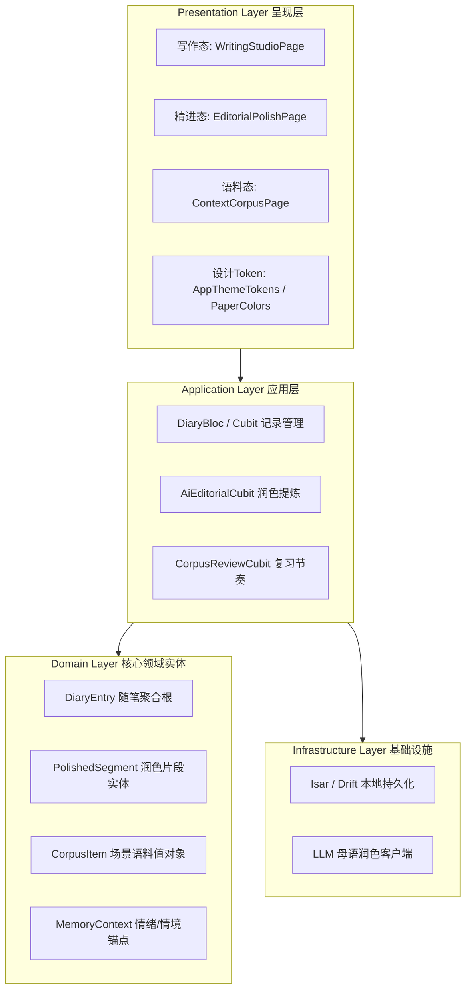

# 《有温度的私人双语创作书房》产品原型设计规范与架构蓝图

> **设计哲学**：“收起教导主任式的严厉，递给用户一支顺滑的钢笔与一张干净的稿纸。”  
> 将真实的个人生活随笔，转化为最高效、无焦虑的专属英语语料库。

---

## 一、视觉与材质系统（Design Tokens）

为了营造如同 Bear、Craft 与高级实体手账般的静谧与沉浸感，我们定义了以下温润、耐看、低饱和的视觉系统：

### 1. 调色盘（Paper & Earth Tone Palette）

| Token 语义 | 浅色纸质模式 (Light Paper) | 深空暗夜模式 (Dark Espresso) | 心理感受与设计意图 |
| :--- | :--- | :--- | :--- |
| `surface.canvas` | `#FAF7F2` (温润米白纸) | `#181715` (深烘焙哑光黑) | 消除强光刺激，模拟优质原生纸质与手账触感 |
| `surface.card` | `#FFFFFF` (纯净纸面) | `#22201D` (柔和暗炭灰) | 卡片轻量层级，微阴影过渡 |
| `text.primary` | `#22201D` (墨黑) | `#F0EDE6` (米灰白) | 高可读性，告别刺眼高对比纯黑 |
| `text.muted` | `#736E65` (褪色墨灰) | `#9E988D` (柔灰) | 辅助信息、原文字段与注释 |
| `accent.terracotta`| `#B8593B` (陶土赭石) | `#D97354` (暖赭红) | 强调地道表达、主行动点，传递温润手作感 |
| `accent.sage` | `#4E6E5D` (鼠尾草绿) | `#759B87` (青苔绿) | 掌握程度与内化完成，传递宁静与生长 |
| `accent.amber` | `#B57D33` (复古琥珀) | `#CCA05E` (暖金) | AI 主编洞察、思维桥梁标签 |

### 2. 排版即界面（Typography-First System）

中英混排是核心高频场景。中西文字符在字高、行高与视重上需要严密契合：
- **英文标题/名句/润色呈现**：选用古典优雅衬线字体（如 `Newsreader` / `New York` / `Playfair Display`）。
- **中文正文/注释**：搭配高通透感衬线/无衬线（如 `Noto Serif SC` 与系统平滑黑体混排）。
- **行高与节奏**：正文行高固定在 `1.8 ~ 1.85`，段间距 `1.2em`，字偶间距（tracking）微调宽松，确保文字留白拥有“可呼吸”的舒适节奏。

---

## 二、三大核心场景与原型界面拆解

### 场景 1：轻量记录态（“零门槛输入” · Writing Flow）

```
┌──────────────────────────────────────────────────────────┐
│  🟢 10月10日 周六 · 21:30        🌧️ 秋夜微雨 · 48字      │
│                                                          │
│  雨夜下班后的热手冲与思绪                                  │
│                                                          │
│  今晚加班到九点多，走出来的时候外面下着很大的雨。            │
│  Today work overtime until 9pm, outside is raining       │
│  heavily. 整个人疲惫到了极点，但街角那家深烘焙手冲的香气，  │
│  忽然让我心里踏实下来。                                    │
│  Feel bone-tired, but that warm cup of pour-over         │
│  quietly grounded me.                                    │
│                                                          │
│                                                          │
│  [  ¶  ] [  🎙️  ]   静默心流中 · 自动存盘    [ 呼叫主编润色 ✨ ] │
└──────────────────────────────────────────────────────────┘
```

* **包容与安全**：完全消除红色波浪纠错线。允许中英夹杂、拼写不完全，绝不打断记录的心流。
* **渐进式浮现（Progressive Disclosure）**：
  * 在打字期间，除纯净光标与文字外，其余界面元素降暗或淡化退去。
  * 停笔或悬停时，底部隐现轻量纸质微工具条，右下角提供带微触感反馈的“呼叫主编润色”按钮。

---

### 场景 2：AI 精进态（“地道化重塑” · Editorial Polish）

摒弃传统教育软件的红绿删除线，以“并排卡片与思维桥梁”形式呈现。

```
┌──────────────────────────────────────────────────────────┐
│  [Ed] 纽约客式温和润色                  [ 返回随笔 ]      │
│  ──────────────────────────────────────────────────────  │
│  ┌─ 句段一 ───────────────────────────────────────────┐  │
│  │ ▎"Today work overtime until 9pm, outside is..."    │  │
│  │                                                    │  │
│  │ “Clocked out after nine tonight into a             │  │
│  │  relentless downpour.”                             │  │
│  │                                                    │  │
│  │ 💡 动词质感: clocked out 替代 work overtime，      │  │
│  │    生活画面感跃然纸上。                              │  │
│  │ 🌊 意象搭配: relentless downpour 传递暴雨压迫情绪。   │  │
│  │                                                    │  │
│  │ [ 一键收录至个人语料库 ✓ ]                          │  │
│  └────────────────────────────────────────────────────┘  │
│                                                          │
│  [ 采用并写回日记 ]            [ 前往情境复习 (2) → ]      │
└──────────────────────────────────────────────────────────┘
```

* **主编身份定位**：AI 扮演纽约客主编（Friendly & Cultivated Editor），重塑语气（Tone）、动词质感（Vivid Verbs）与习语搭配（Natural Collocations）。
* **思维桥梁（Mindset Bridge）**：每条润色都附带中文思维到英文母语思维的转变解析，保护用户的表达欲与自尊心。

---

### 场景 3：动态语料沉淀态（“场景化内化” · Contextual Corpus）

背单词不再是孤立背字典，而是唤醒“写这篇随笔时的记忆与情绪”。

```
┌──────────────────────────────────────────────────────────┐
│  🌧️ 唤醒记忆 · 10月10日 雨夜加班随笔                      │
│  ──────────────────────────────────────────────────────  │
│  ┌─ [ 3D 翻转卡片 ] ──────────────────────────────────┐  │
│  │  [正面：语境触发]                                  │  │
│  │  relentless downpour                               │  │
│  │  /rɪˈlentləs ˈdaʊnpɔːr/                            │  │
│  │                                                    │  │
│  │  当时你写下的情境原句：                             │  │
│  │  “Clocked out after nine tonight into a            │  │
│  │   relentless downpour.”                            │  │
│  │                                                    │  │
│  │  “还记得走出写字楼大门时扑面而来的潮湿吗？”          │  │
│  │                                 [ 轻触翻面 ↺ ]     │  │
│  └────────────────────────────────────────────────────┘  │
│                                                          │
│  ← 上一张          [触感震动反馈]          下一张 →      │
└──────────────────────────────────────────────────────────┘
```

* **情境锚定（Context Anchor）**：卡片直接附带随笔创建时刻的天气、心情与完整上下文原句。
* **轻盈翻转与手势体验**：双面卡片交互，正面为表达与情境提示，背面为深度母语搭配与变体用法。

---

## 三、Flutter 架构规划（遵循 DDD 与跨平台规范）

为保障代码坚实、禁止硬编码及补丁式代码，我们提前规划领域层（Domain Layer）实体与组件分层：



1. **响应式与多端原生体验**：
   - **移动端（Mobile）**：单手拇指热区控制、底部卡片滑动手势、轻量 Haptic 触感反馈。
   - **桌面/平板（Desktop/Tablet）**：左侧随笔列表、中央写作画卷、右侧可折叠的主编对话抽屉，支持键盘快捷键（如 `Cmd/Ctrl + Enter` 一键呼叫润色）。
2. **统一单一信源（Single Source of Truth）**：
   - 色彩系统与排版字体由全局 `AppThemeTokens` 单一类驱动，杜绝魔法数字与零散硬编码。
